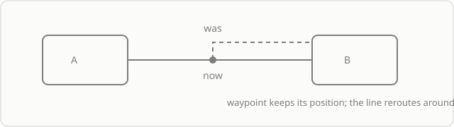

## Model

A connector is an object with two ends. Each end stores the **identifier of an object**, not a point on the canvas. Everything else follows from this:

- the line is rebuilt when the object is moved;
- deleting an object deletes the connector;
- "drag an end onto another object" is a change of identifier, not drawing the line again.

## Anchors

Anchors are four points on the edge of an object, one at the middle of each side. They are visible on a **selected** object: while the object is not selected, the same mouse movement moves it instead of creating a connector.

A click on an anchor asks "what stands in this place": when the slot is free, a connected copy of the object appears one gap away; when the slot is taken by a connectable object, the two objects are joined with a line. Dragging from an anchor to another object also joins them. A pair that already has a line does not get a second one.

The side of the anchor is chosen by the relative position of the objects. If you move an object around another one, the line moves to the nearest side. A connector joins a marquee selection only with both of its ends: a line with one end outside is a broken relation, not a separate object.

## Routing

| Routing | When it fits |
|---|---|
| straight | a short connector between objects standing next to each other |
| angular | a diagram where horizontals and verticals matter |
| curved | an organic diagram where sharp corners get in the way |

Routing is a property of the connector, not a global setting: different routings can coexist in one diagram.

## Waypoints

A point is added by dragging a segment of the line and stays attached to the connector. Such a point is **fixed**: when the ends move, it keeps its position, so the line goes around an obstacle. A double click on a point deletes it and joins the segments.

The limit is 32 points per connector.

## Model limits

- One pair of objects — one connector. A second line between the same objects cannot be created.
- A connector from an object to itself is not allowed.
- A frame and a kanban cannot be an end: they have no edge to attach to. A kanban card can be an end — the line follows its cell.

## Where to go next

[Connectors](/guide/capabilities/connectors) — what this gives in practice and where the limit is.
