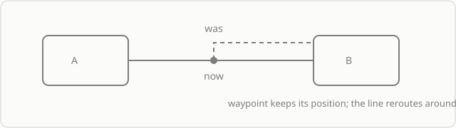

## Модель

Связь — объект, у которого есть два конца. Каждый конец хранит **идентификатор объекта**, а не точку на холсте. Из этого следует всё остальное:

- линия перестраивается, когда объект двигают;
- удаление объекта удаляет связь;
- «перетащить конец на другой объект» — это смена идентификатора, а не рисование заново.

## Якоря

Якоря — четыре точки на краю объекта, по одной в середине каждой стороны. Они видны у **выделенного** объекта: пока объект не выделен, то же движение мышью перемещает его, а не создаёт связь.

Клик по якорю спрашивает «что стоит на этом месте»: если рядом есть свободное место, появится связанная копия объекта шагом в одну щель; если место занято соединяемым объектом, два объекта соединятся линией. Потянуть от якоря к другому объекту — тоже соединить. Пара, у которой уже есть линия, второй не получает.

Сторона якоря выбирается по взаимному расположению объектов. Если двигать объект вокруг другого, линия переходит на ближайшую сторону. Связь входит в выделение рамкой только вместе с обоими концами: линия без одного конца — разорванное отношение, а не отдельный объект.

## Маршрут

| Маршрут | Когда уместен |
|---|---|
| прямой | короткая связь между рядом стоящими объектами |
| угловой | схема, где важны горизонтали и вертикали |
| кривой | органичная схема, где острые углы мешают |

Маршрут — свойство связи, а не глобальная настройка: в одной схеме могут соседствовать разные.

## Точки перегиба

Точка добавляется перетаскиванием сегмента линии и остаётся привязанной к связи. Такая точка **жёсткая**: при движении концов она сохраняет своё положение, поэтому линия огибает препятствие. Двойной щелчок по точке удаляет её и соединяет сегменты.

Предел — 32 точки на связь.

## Ограничения модели

- Одна пара объектов — одна связь. Вторую линию между теми же объектами создать нельзя.
- Связь объекта с самим собой запрещена.
- Фрейм и канбан не могут быть концом: у них нет края, к которому можно привязаться. Карточка канбана концом быть может — линия следует за её ячейкой.

## Куда дальше

[Связи](/guide/capabilities/connectors) — что это даёт в работе и где предел.
