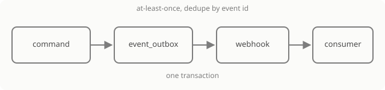

## Principle

An extension does not get access to the product's browser. Instead the product provides three things: **events** about what happened, a **token** for actions without a session, and a **declarative panel** for the interface. Foreign JavaScript, HTML and iframes do not run — this is not a setting but a boundary.

## Three parts

| Part | What it gives | Who configures it |
|---|---|---|
| [Events and webhook](/guide/capabilities/events) | the server itself reports a change on the board | organisation administrator |
| [Integration token](/guide/capabilities/tokens) | an action on behalf of a specific person, but only within their rights and scope | organisation administrator |
| [App](/guide/capabilities/apps) | a panel on the board, drawn from a schema | organisation administrator |

The parts combine: the webhook reports an event, the integration verifies the signature, reads the board with a token and changes it with a command. The app shows the result to a person and can invoke its own action.

## What counts as an event

An event is a domain fact, not a change of document bytes. It always answers the questions: what happened, on which board, by whom and with which object. That is why "a user dragged a sticky note" is not an event, while "an object was created" is.

The list of types and the envelope are in the [event reference](/guide/reference/events).

## What is not here

A marketplace, third-party apps, iframes, loading external code, billing and a catalog. When any of these appears, it will be a separate decision, not a quiet setting.

## Where to go next

[Events and webhook](/guide/capabilities/events) — the first part an integration starts with.
