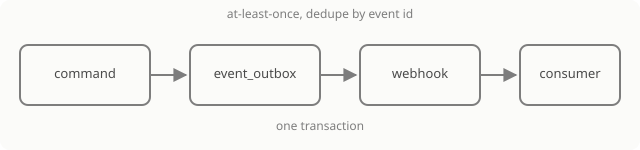

## Принцип

Расширение не получает доступ к браузеру продукта. Вместо этого продукт отдаёт три вещи: **события** о том, что произошло, **токен** для действий без сессии и **декларативную панель** для интерфейса. Чужой JavaScript, HTML и iframe не выполняются — это не настройка, а граница.

## Три части

| Часть | Что даёт | Кто настраивает |
|---|---|---|
| [События и вебхук](/guide/capabilities/events) | сервер сам сообщает об изменении в комнате | администратор организации |
| [Токен интеграции](/guide/capabilities/tokens) | действие от имени конкретного человека, но только в пределах его прав и scope | администратор организации |
| [Приложение](/guide/capabilities/apps) | панель в комнате, нарисованная по схеме | администратор организации |

Части сочетаются: вебхук сообщает о событии, интеграция проверяет подпись, читает комнату токеном и меняет её командой. Приложение показывает человеку результат и может вызвать своё действие.

## Что считается событием

Событие — это факт домена, а не изменение байтов документа. Оно всегда отвечает на вопросы: что произошло, на какой комнате, кем и с каким объектом. Поэтому «пользователь перетащил стикер» событием не является, а «создан объект» — является.

Список типов и конверт — в [справочнике событий](/guide/reference/events).

## Чего здесь нет

Маркетплейса, сторонних приложений, iframe, загрузки внешнего кода, биллинга и каталога. Когда что-то из этого появится, это будет отдельным решением, а не тихой настройкой.

## Куда дальше

[События и вебхук](/guide/capabilities/events) — первая часть, с которой начинается интеграция.
